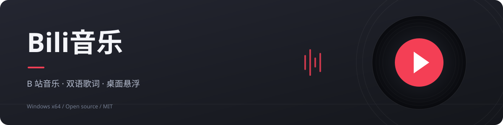
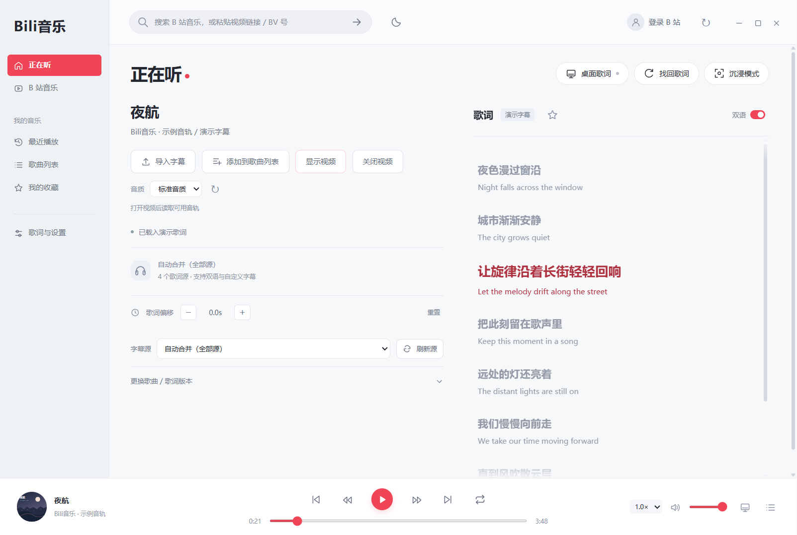
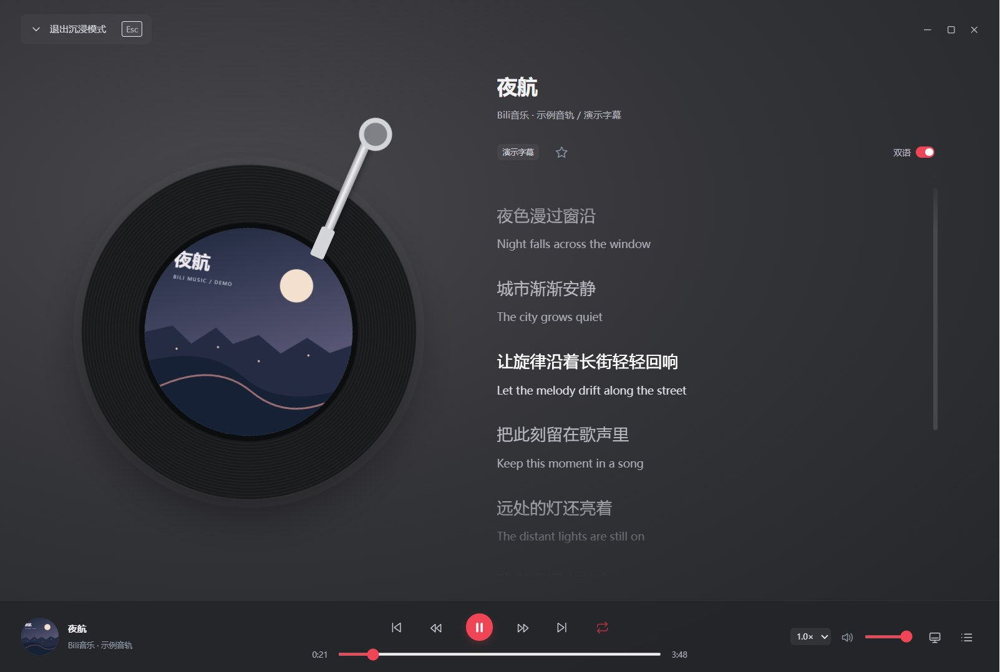
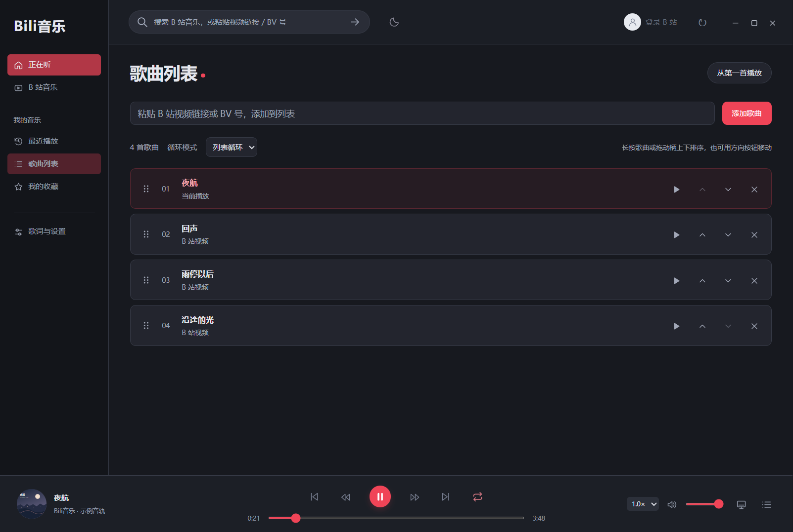

<p align="center"></p>

<p align="center">
  <a href="https://github.com/hayashinori/bili-music/releases"></a>
  
  <a href="LICENSE"></a>
  
</p>

<p align="center">把 B 站里的音乐，放进一个专注听歌的桌面播放器。</p>

<p align="center">
  <a href="https://github.com/hayashinori/bili-music/releases/latest"><strong>下载 Windows 版</strong></a> ·
  <a href="#界面预览">界面预览</a> ·
  <a href="docs/DEVELOPMENT.md">开发与构建</a> ·
  <a href="https://github.com/hayashinori/bili-music/issues">反馈问题</a>
</p>

## 能做什么

| 音乐与播放 | 歌词与桌面 |
| --- | --- |
| 内嵌 B 站官方页面，登录自己的账号 | 根据视频标题搜索并匹配带时间轴歌词 |
| 搜索视频，粘贴链接或 BV 号播放 | 网易云、QQ 音乐、酷狗、LRCLIB 四个源 |
| 读取自己的收藏夹，管理最近播放 | 快捷切源、刷新、收藏指定歌词版本 |
| 本机歌曲列表、长按排序、上一首／下一首 | 双语、独立字号、LRC / SRT / VTT 导入 |
| 顺序播放、列表循环、单曲循环 | 时间偏移、按句校准、点击歌词跳转 |
| 全局明暗模式、主题色、唱片沉浸模式 | 置顶桌面歌词、透明／兼容背景、拖动拉伸 |

## 界面预览

图片使用独立测试配置和示例文字，不包含真实账号、收藏夹或登录信息。

### 正在听

左侧管理歌曲和字幕源，右侧保留完整的滚动歌词空间。



<table>
  <tr>
    <td width="50%"><strong>沉浸模式</strong><br>唱针随播放落下，暂停抬起；按 Esc 返回。</td>
    <td width="50%"><strong>暗色歌曲列表</strong><br>长按拖动排序，循环模式与顺序自动保存。</td>
  </tr>
  <tr>
    <td></td>
    <td></td>
  </tr>
</table>

## 开始使用

1. 从 [Releases](https://github.com/hayashinori/bili-music/releases) 下载 Windows x64 压缩包，解压后运行 **BanCi.exe**，保留同文件夹中的其他文件。首次发布尚在构建时，可按[开发说明](docs/DEVELOPMENT.md)从源码启动。
2. 在应用里登录 B 站，或直接播放公开视频。顶部可以搜索、粘贴视频链接或输入 BV 号。
3. 回到「正在听」，自动匹配歌词；版本不合适时，在左栏切换字幕源或搜索其他版本。
4. 点击「桌面歌词」显示浮窗，或点击「沉浸模式」进入唱片界面。

预编译版无需安装 Node.js、Python 或浏览器扩展。升级时先退出旧版，再打开新版，原有本机数据继续使用。

| 快捷键 | 操作 |
| --- | --- |
| `Space` | 播放／暂停，输入框内除外 |
| `Esc` | 退出沉浸模式 |
| `Ctrl + Alt + D` | 显示／隐藏桌面歌词 |
| `Ctrl + Alt + L` | 找回歌词窗口并解锁 |

## 歌词同步说明

使用**来源已有的时间轴 + 视频播放时间**同步字幕。相同录音版本通常可以直接跟随；片头、剪辑、翻唱或现场版可用偏移和按句校准调整。

没有音频听歌识曲、歌声强制对齐或自动翻译。双语取决于来源是否提供翻译，也可自行导入；着色按句间时间估算，并非真实逐字时间轴。

## 登录与本机数据

- 登录使用 B 站官方网页，账号会话保存在应用自己的 Electron 分区。应用读取头像、昵称和收藏夹，不将 Cookie 提供给歌词源。
- 列表、主题、最近播放、字幕与偏移保存在 `%APPDATA%\伴词桌面`。请勿把该目录上传到仓库或随反馈发送。
- 自动匹配会将整理后的歌名关键词发送给所选歌词源。没有自建账号系统或分析统计服务。
- 关闭主窗口会退出；最小化可继续播放和显示桌面歌词。B 站网页与视频解码仍会占用资源。

## 开发

建议使用 Node.js 24，在 Windows 上运行桌面版。

```sh
npm ci
npm start
npm test
npm run package
```

架构、原生窗口测试与发行包构建见 [开发说明](docs/DEVELOPMENT.md)；历史改动见 [更新记录](docs/HISTORY.md)；验证范围见 [测试记录](VALIDATION.md)。

## 参与贡献

欢迎提交问题和 PR。报告故障时请注明版本、Windows 版本、操作步骤和错误提示；涉及视频时可附公开视频链接。不要上传 Cookie、密码、二维码或整个用户数据目录。

详见 [贡献指南](CONTRIBUTING.md) 和 [安全问题反馈](SECURITY.md)。

## 许可证与致谢

源码采用 [MIT License](LICENSE)。音乐、视频、歌词、封面和第三方依赖分别遵循各自权利与许可证；本项目与哔哩哔哩及各音乐平台没有官方关联，不提供音频下载或权限绕过。

基于 [Electron](https://www.electronjs.org/) 构建。歌词接口结构参考 [Listen 1](https://github.com/listen1/listen1_chrome_extension) 与 [LyricsKit](https://github.com/ddddxxx/LyricsKit)，实现说明见 [第三方说明](THIRD_PARTY_NOTICES.md)。
